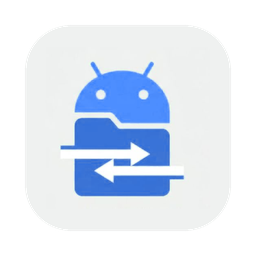
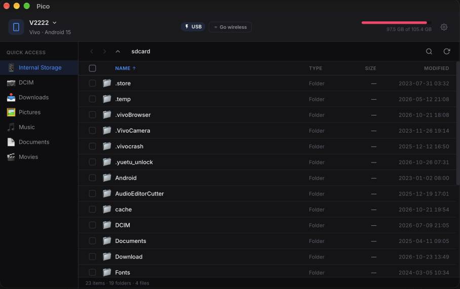

<p align="center">
  
</p>

<h1 align="center">Pico</h1>

<p align="center">
  Your Android files, on your Mac. Browse your phone's storage and move files both ways, over USB or Wi-Fi.<br>
  <a href="https://a3in1.github.io/Pico/"><b>Download</b></a> ·
  <a href="https://github.com/A3In1/Pico/releases">Releases</a> ·
  <a href="CHANGELOG.md">Changelog</a>
</p>



## Features

- **Fast transfers.** Pico talks to your phone through `adb`, not MTP, so transfers are quicker and more reliable. `adb` is bundled; nothing else to install.
- **Both directions.** Download to your Mac, upload to your phone, or drag files and folders between Pico and Finder.
- **USB or Wi-Fi.** Plug in a cable, or pair over Wi-Fi with a pairing code. **Go wireless** switches a USB-connected phone to Wi-Fi.
- **Several phones at once.** Switch between connected devices from the device menu.
- **Quick access.** Jump to DCIM, Downloads, Pictures, Music, Documents and Movies, plus the SD card if there is one.
- **Handles big folders.** The file list is virtualised, so folders with thousands of files stay smooth. Search and sort by name, type, size or date.
- **Safe copies.** Choose Ask, Keep Both, Replace or Skip when a file already exists. Transfers show progress and can be cancelled; half-finished files are never left behind.
- **Quick preview.** Open images, videos and PDFs in the macOS viewer.
- **Light and dark themes**, keyboard shortcuts and automatic updates.

## Install

1. Download the latest `.dmg` from the [website](https://a3in1.github.io/Pico/) or [Releases](https://github.com/A3In1/Pico/releases/latest).
   Requires **macOS 11 or later**, on Apple Silicon or Intel.
2. Open the DMG and drag **Pico** into **Applications**.
3. The first time you open it, macOS may say it can't verify the developer, because the app isn't notarized yet. Go to **System Settings → Privacy & Security** and click **Open Anyway**. Or run:
   ```sh
   xattr -dr com.apple.quarantine /Applications/Pico.app
   ```

### Updating

Pico checks for updates every time it launches. You can also use **Pico → Check for Updates…** in the menu bar. When a new version has been downloaded, the item changes to **Restart to Update**. Click it and Pico relaunches on the new version (it asks first if transfers are still running).

## How to use

1. **Prepare your phone.** Turn on **Developer options** (Settings → About phone → tap **Build number** seven times), then turn on **USB debugging**. For Wi-Fi, also turn on **Wireless debugging**.
2. **Connect.** Plug the phone in and tap **Allow** on the "Allow USB debugging?" prompt. For Wi-Fi, open Pico's wireless connect screen and pair with the code shown under **Wireless debugging** on the phone, or press **Go wireless** while connected over USB.
3. **Browse.** Pick a folder from **Quick Access** or navigate from Internal Storage.
4. **Transfer.** Select files and press `⌘D` to download them to your download folder, or drag them into Finder. To upload, drag files from Finder onto Pico.
5. **Tune it.** **Settings** (gear icon) has the download location, theme, conflict handling and the quit reminder.

### Keyboard shortcuts

| Action | Shortcut |
| --- | --- |
| Select all / deselect | `⌘A` / `Esc` |
| Download selected | `⌘D` |
| Back / forward / parent folder | `⌘[` / `⌘]` / `⌘↑` |
| Open folder | `Enter` |
| Refresh | `⌘R` |
| Search | `⌘F` |
| Toggle sidebar | `⌘\` |

## Build from source

Requirements: Node.js 18+, Rust (stable) and the [Tauri prerequisites](https://v2.tauri.app/start/prerequisites/). The `adb` binary is already in `src-tauri/resources/`.

```sh
npm install
npm run tauri dev
```

Tests (no phone needed): `npm test`. See [tests/README.md](tests/README.md).

To build a local app bundle, run `npm run tauri build`. Because update signing is turned on, it needs the updater key:
`TAURI_SIGNING_PRIVATE_KEY=~/.tauri/pico.key TAURI_SIGNING_PRIVATE_KEY_PASSWORD='<key password>' npm run tauri build`

The app icon (light + dark) is `src-tauri/icons/Pico.icon` (open it in Xcode's Icon Composer). After editing it, rebuild the compiled catalog the bundle ships:
`xcrun actool src-tauri/icons/Pico.icon --compile /tmp/pico-icon --platform macosx --minimum-deployment-target 11.0 --app-icon Pico --output-partial-info-plist /tmp/pico-icon/p.plist && cp /tmp/pico-icon/Assets.car src-tauri/icons/`

## Releasing (maintainers)

```sh
# 1. Add the new version's notes to CHANGELOG.md and commit them.
npm version patch            # bumps package.json (the single version source), commits, tags vX.Y.Z
git push --follow-tags       # GitHub Actions builds the universal DMG + updater files into a draft release
gh release edit vX.Y.Z --draft=false --latest   # publish: the website and in-app updater pick it up
```

The website in `site/` deploys to GitHub Pages automatically on push to `main`.

## Contributing

Contributions are welcome. See [CONTRIBUTING.md](CONTRIBUTING.md).

## License

Pico is released under the [MIT License](LICENSE). The bundled `adb` is from the Android Open Source Project under the Apache License 2.0; it and other third-party components are listed in [THIRD_PARTY_NOTICES.md](THIRD_PARTY_NOTICES.md). Android is a trademark of Google LLC; Pico is not affiliated with Google.
